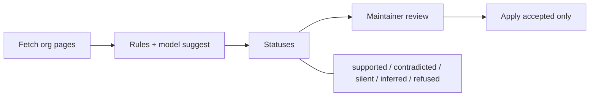

# Atlas Receipts

**TOA Track A / Chart the Common Wealth.** One page. Team: VJ-yadav, pjsk02.

## Problem

The Mass AI Atlas makes **1,080 checkable claims** about 197 Massachusetts AI organizations, and **none of them links to a source**. "Verified" is a single month stamp on the whole entry, so a founder cannot tell whether *this* check size still holds, and the maintainer re-checks whole entries blind.

## Unique idea

Every claim gets a **receipt**: the org's own URL, the exact sentence on that live page, when it was fetched, and the page hash. **"Verified" means that sentence is still on the live page, per claim.** That is Probe 8: claims code can prove from the org's own site.

**Trust rule:** the model may suggest, code checks, a person decides. Only code can mark `supported`. Claude's readings stay `inferred` (never verified). Sites we will not collect stay `refused`.

## Flow



Check finds receipts. Review Accept/Rejects. Apply writes only accepted rows to an Atlas branch, then runs the Atlas validator. Re-check (`changes`) returns only claims whose sentence moved.

## Numbers (final run)

Generated by `python -m receipts metrics` from `after/metrics.json`, the one source the console and README use.

<!-- metrics:start -->
**Probe 8: claims with a receipt, 0 → 373 of 1,080 verified by code.** 665 carry a sentence from the org's own page (288 of them are Claude's readings, labelled inferred; 4 are sentences that contradict the Atlas).

```
supported 373 · contradicted 4 · silent 400 · inferred 288 · refused 15      (checked 2026-10-31 18:47Z)
```

| Number | Value |
|---|---|
| Probe 8: claims verified by code | 0 → **373 / 1,080** |
| Claims carrying a sentence from the org's own page | 665 |
| Claims that need a person (contradicted, silent, inferred) | 692 |
| Real contradictions | 4: salesforce-bos, matrix, accomplice, deltav |
| Probe 5: the 52 entries last checked in June | 39 confirmed live by their own site; 2 with a contradiction; 92 of 256 claims verified |
| Links with a receipt | 69 / 170 |
| A founder's 12-funder shortlist | 0 → 25 / 83 verified (70 with a sentence) |
| Planted errors: caught / missed / false alarms | 6 / 0 / 1 of 6 |
| Click test, random receipts | 5 / 5 land on their sentence |
| Pages read from the orgs' own sites | 962 |
| Sites that block bots (respected) | 28 |
| Model (claude-haiku-5-5): cost of reading all 197 | $0.05 over 199 calls |
| Validator on the Atlas branch | PASSED: data/ is valid. |
<!-- metrics:end -->

## Why it helps

- **Founders:** each claim can show clickable proof on the funder's own page today.
- **Maintainer Monday:** queue is only changed, silent, or contradicted claims, not 17 random entries at 10-15 minutes each.
- **Honesty:** refused stays refused; inferred is never sold as verified; contradictions show both values and wait for a person.

## Unique vs a freshness engine

A monthly "revisit the site" stamp is not enough. Atlas Receipts is **claim-level** (not entry-level), **calibrated** on planted errors, and scored publicly as **Probe 8** (code-proven receipts only). Next month only moved sentences come back.

## Attribution

Mass AI Atlas, The Open Accelerator, CC BY 4.0. Proposed tool for the Atlas maintainer; not part of the public Atlas.
