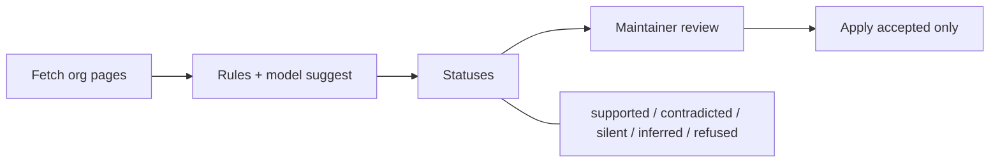

# Atlas Receipts

**TOA Track A / Chart the Common Wealth.** One page. Team: VJ-yadav, pjsk02.

## Problem

The Mass AI Atlas makes **1,080 checkable claims** about 197 Massachusetts AI organizations, and **none of them links to a source**. "Verified" is a single month stamp on the whole entry, so a founder cannot tell whether *this* check size still holds, and the maintainer re-checks whole entries blind.

## Unique idea

Every claim gets a **receipt**: the org's own URL, the exact sentence on that live page, when it was fetched, and the page hash. **"Verified" means that sentence is still on the live page, per claim.** That is Probe 8: claims code can prove from the org's own site.

**Trust rule:** the model may suggest, code checks, a person decides. Only code can mark `supported`. Claude's readings stay `inferred` (never verified). Sites we will not collect stay `refused`.

## Flow



Check finds receipts. Review Accept/Rejects. Apply writes only accepted rows to an Atlas branch, then runs the Atlas validator. Re-check (`changes`) returns only claims whose sentence moved.

## Numbers (final run, Track 2)

| | |
|---|---|
| **Probe 8** | **0 → 380 / 1,080** verified by code |
| With a sentence from the org's page | ~667 (380 supported + inferred + contradicted with a quote) |
| Needs a person | contradicted, silent, inferred |
| Planted errors | 6 caught / 0 missed / 1 false alarm (recall 1.0) |
| Click test | 5 / 5 land on their sentence |
| Goals | **14 / 14** met |
| Validator on Atlas branch | PASSED |

```
supported 380 · with a sentence ~667
```

## Why it helps

- **Founders:** each claim can show clickable proof on the funder's own page today.
- **Maintainer Monday:** queue is only changed, silent, or contradicted claims, not 17 random entries at 10-15 minutes each.
- **Honesty:** refused stays refused; inferred is never sold as verified; contradictions show both values and wait for a person.

## Unique vs a freshness engine

A monthly "revisit the site" stamp is not enough. Atlas Receipts is **claim-level** (not entry-level), **calibrated** on planted errors, and scored publicly as **Probe 8** (code-proven receipts only). Next month only moved sentences come back.

## Attribution

Mass AI Atlas, The Open Accelerator, CC BY 4.0. Proposed tool for the Atlas maintainer; not part of the public Atlas.